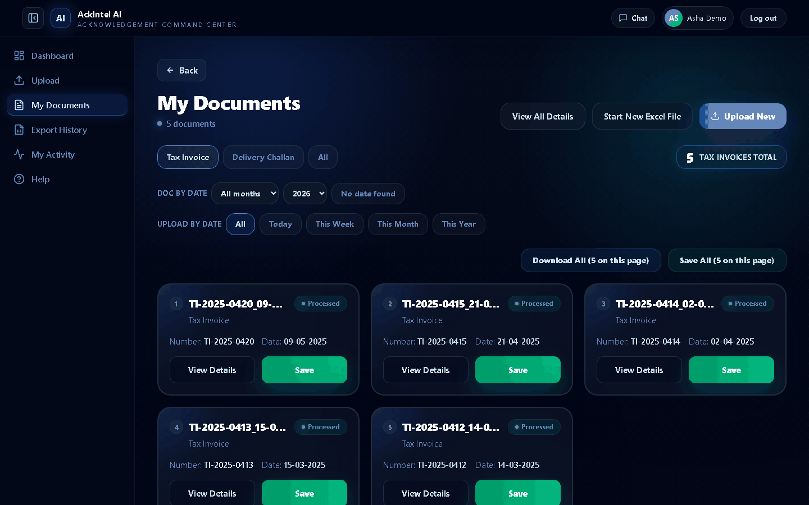
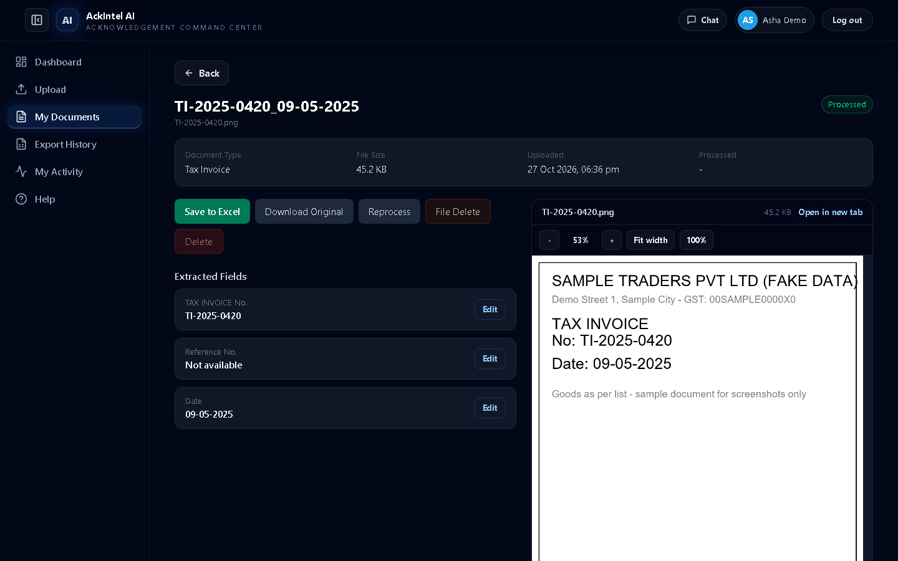
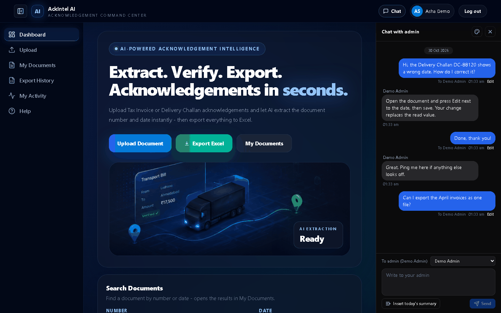
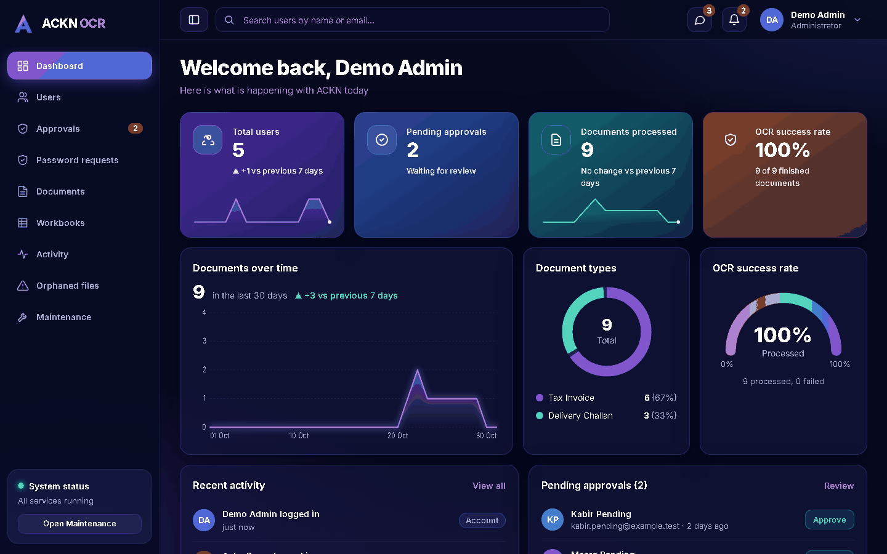
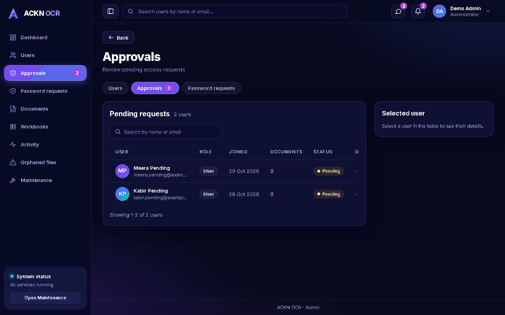
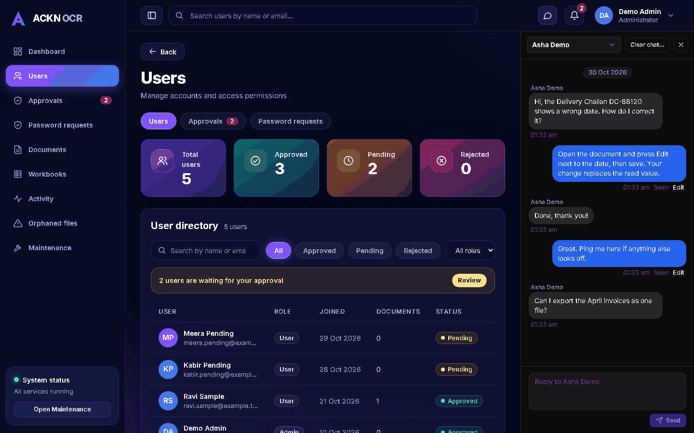
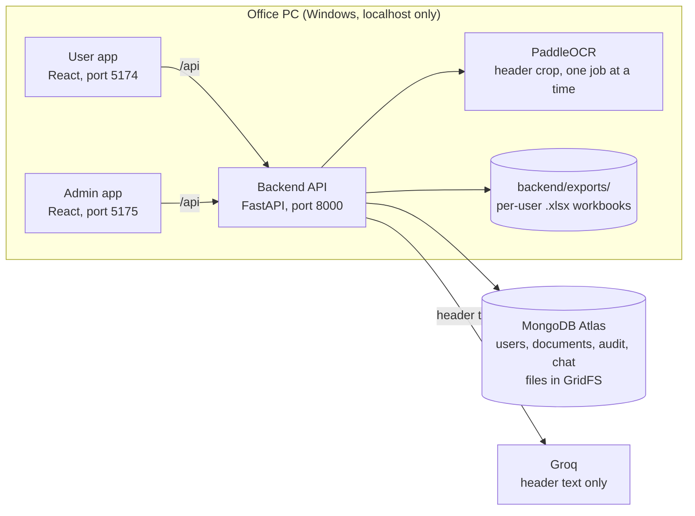

# AckIntel AI

**Acknowledgement document intelligence.** Upload a Tax Invoice or Delivery Challan (photo or PDF), and AckIntel AI reads the document number and date for you, lets you check and correct them, and files everything into organised Excel workbooks.

It is a Windows desktop-style tool, built for one office PC: private per-user accounts, an admin approval step for new users, and an admin panel for support and oversight. The app itself runs only on that PC and is not published on the internet. It does use two online services: MongoDB Atlas stores the data, and Groq receives the header text of each document to pick out the number and date (never the image or the rest of the page).

## At a glance

**Upload** a document → **check** the number and date beside the original → **save** to Excel → find it in your yearly workbook, filed under the right month.

- Review and edit with the original file always in view
- Excel files that are written safely, even while you have them open
- Private accounts with admin approval and a full audit trail
- Clear flags for anything that looks unusual, so nothing slips through quietly
- A built-in chat between each user and the admins

## Screenshots

All screenshots use made-up demo accounts and sample documents. No real data is shown.

| | |
|---|---|
|  |  |
| **My Documents.** Filter by type, month and upload date, then save or download a whole page. | **Review.** Check or edit the number and date with the original always in view. |
|  |  |
| **Chat.** Ask an admin for help without leaving the page. | **Admin dashboard.** Totals, reading success and pending approvals. |
|  |  |
| **Approvals.** New accounts wait here until an admin decides. | **Admin chat.** Reply to users and see unread counts. |

---

## Contents

- [What it does](#what-it-does)
- [How a document is read](#how-a-document-is-read)
- [Architecture](#architecture)
- [Quick start](#quick-start)
- [Configuration](#configuration)
- [Using the app](#using-the-app)
- [Chat](#chat)
- [Excel export rules](#excel-export-rules)
- [Data quality safeguards](#data-quality-safeguards)
- [Admin panel](#admin-panel)
- [Security](#security)
- [Operations](#operations)
- [Development](#development)
- [Troubleshooting](#troubleshooting)
- [Known limitations](#known-limitations)

---

## What it does

| Area | Details |
|---|---|
| **Reading documents** | Reads the **Tax Invoice No.** and **Reference No.** (Tax Invoice) or the **Delivery Challan No.** (Delivery Challan), plus the **date**. Accepts PDF, JPG, JPEG and PNG up to 5 MB each. PDFs can have up to 4 pages, and images up to 50 megapixels, which covers typical phone photos and scans. |
| **Photos** | Phone photos are cropped to the page, straightened (small tilts) before reading. |
| **Upload** | Single upload, or bulk upload of up to 10 files at once. |
| **Review** | The original file is shown next to the extracted values (zoom and pan for PDFs). Any value can be corrected by hand. |
| **Excel** | One workbook per year, one sheet per month. Save one document or a whole page at once. |
| **Accounts** | Email and password, or Google Sign-In. New accounts wait for admin approval. |
| **Chat** | A small text chat between each user and the admins, inside both apps. |
| **Admin panel** | Approve users, handle password requests, browse all documents and workbooks, read the audit log, answer chat, and run maintenance. |

Each person only ever sees their own documents, workbooks and export history.

## How a document is read

```text
 Upload (PDF / image)
        │
        ▼
 Page cleanup ── crops to the paper, straightens, only enhances rough scans
        │
        ▼
 OCR (PaddleOCR, on this PC) ── reads only the header at the top of the page
        │
        ▼
 Field extraction (Groq) ── a language model picks out the number(s) and the date
        │
        ▼
 Safety checks (plain Python, no AI) ── type check, format fixes, review flags
        │
        ▼
 You review and correct ── then save to Excel
```

Things worth knowing:

- Only the top part of the page is read. The numbers and date sit in the header, and ignoring the rest keeps reading fast and accurate.
- The first document after the app starts is slower, because the reading model takes up to a minute or two to load. After that it stays in memory.
- Documents are processed **one at a time**, on purpose, to keep memory use safe on a single PC. A bulk upload of 10 files takes about ten times as long as one file.
- The AI step is treated as untrusted. Whatever it returns is cleaned and checked before it is stored (see [Data quality safeguards](#data-quality-safeguards)).

## Architecture



- The two web apps are static builds served on this PC. They call the backend through `/api`.
- The backend keeps all records and uploaded files in MongoDB Atlas. Excel workbooks are real files on this PC.
- Only the text of the page header is sent to Groq. The image and the rest of the page never leave the PC.

## Quick start

This is the setup for the office PC. It runs everything locally on Windows.

**You need**

- Windows, with Python 3.12 installed
- Node.js 20.19+ or 22.12+
- A MongoDB Atlas connection string
- Optional: one or more Groq API keys (without them, documents upload but cannot be read)

**Steps**

1. Create the Python environment once. Open a terminal in the project folder and run `python -m venv venv`.
2. Copy `backend/.env.example` to `backend/.env` and fill it in. See [Configuration](#configuration).
3. Double-click **`setup.bat`**. It installs the backend packages and builds both web apps. Run it once, and again after any frontend code change. Stop the app first with `stop.bat`, because Windows locks files that are in use.
4. Create the admin accounts once (needs the `ADMIN_*` values from step 2, and `setup.bat` refuses to run while `backend/.env` is missing or empty). This is safe to repeat:

   ```bash
   cd backend
   ../venv/Scripts/python.exe -m app.scripts.seed_admin
   ```

5. Double-click **`start.bat`** every day. It starts everything and opens the app.
6. **First sign-in.** Open the admin app (<http://localhost:5175>) and sign in with the admin email and password you set in `.env`. Open **Approvals** to approve new users. Each user then signs in at <http://localhost:5174>.

| Part | Address | Port |
|---|---|---|
| User app | <http://localhost:5174> | 5174 |
| Admin app | <http://localhost:5175> | 5175 |
| Backend API | <http://127.0.0.1:8000> | 8000 |

All three listen on this PC only (`127.0.0.1`). Other computers cannot reach them.

To stop, double-click **`stop.bat`**. It only stops what `start.bat` started. A document that was being processed is queued again at the next start.

**Updating the app:** run `stop.bat`, pull the new code, run `setup.bat`, then `start.bat`.

## Configuration

All settings live in `backend/.env`. A missing or invalid required setting stops the app at start with a clear message. It never starts half-configured.

| Variable | Required | Default | What it does |
|---|---|---|---|
| `MONGO_URI` | **Yes** | — | MongoDB Atlas connection string. |
| `JWT_SECRET` | **Yes** | — | Signs login tokens. At least 32 characters. Generate one with `python -c "import secrets; print(secrets.token_hex(48))"`. |
| `MONGO_DB_NAME` | No | `ackn_AI_model` | Database name. Blank means the default. |
| `GROQ_API_KEYS` | No | — | One or more Groq keys, comma-separated. Calls are spread evenly across keys, and if one key is rate-limited or rejected the next is tried. |
| `GROQ_MODEL` | No | `openai/gpt-oss-120b` | Model used for extraction. The app never switches models on its own. |
| `GROQ_REASONING_EFFORT` | No | `high` | `low`, `medium` or `high`. Set it **blank** for a model that has no reasoning mode, so the setting is not sent. |
| `GROQ_MAX_TOKENS` | No | `2000` | Reply length limit, a whole number from 50 to 4000. If an answer is cut off it is retried once with double the limit (at most 4000); if it is still cut off the document fails with a message asking you to raise this value. |
| `AUDIT_LOG_RETENTION_DAYS` | No | `365` | Audit entries older than this are deleted automatically. `0` keeps them forever. Whole number from 0 to 3650. |
| `GOOGLE_CLIENT_ID` | No | — | Turns on Google Sign-In. Put the same value in `frontend/.env` as `VITE_GOOGLE_CLIENT_ID=<value>` (copy `frontend/.env.example`) before running `setup.bat`, so the sign-in button is built into the user app. Without it the Google button is simply not shown. |
| `FRONTEND_ORIGIN` | No | `http://localhost:5174` | Allowed browser origin for the user app. |
| `ADMIN_ORIGIN` | No | `http://localhost:5175` | Allowed browser origin for the admin app. |
| `ADMIN_1_NAME`, `ADMIN_1_EMAIL`, `ADMIN_1_PASSWORD` | Seeding only | — | First admin account. Also `ADMIN_2_*` for the second. The password is used once; only its hash is stored. |
| `ENABLE_DOCS` | No | off | `true` shows the API documentation pages (`/docs`, `/redoc`). Use on a developer machine only. |

**Changing the Groq model:** set the new `GROQ_MODEL`, clear `GROQ_REASONING_EFFORT` if the model has no reasoning mode, restart the backend, then upload one test document to confirm it is read. If a model is retired by Groq, users see "The AI service is not set up correctly" and the log shows the reason.

**Audit retention note:** the first time the app starts with retention on, entries older than the limit are removed by MongoDB. Set `AUDIT_LOG_RETENTION_DAYS=0` before that first start if you want to keep older history.

## Using the app

### Getting an account

1. Sign up with email and password, or continue with Google.
2. The request waits for an admin. The sign-in page tells you your request was sent.
3. When an admin approves it, sign in again. You will see a short "you're approved" notice once.

**Using Google with an existing account.** The first time you continue with Google on an account that already has a password, the two are linked and you sign in with Google from then on. The old password is retired and earlier sessions end, which keeps the account tied to the person who owns the Google address. Admin accounts keep their password as well.

If a request is rejected, or access is later removed, the sign-in page shows the date and the reason the admin gave. A wrong password never reveals any of this.

**Forgot your password?** Use "Request password reset" on the sign-in page. An admin gives you a temporary password in person or by phone, and you choose a new one at your next sign-in. There is no reset email.

### Uploading and reviewing

1. Open **Upload**, choose **Tax Invoice** or **Delivery Challan**, and add a file. For several files, use bulk upload (up to 10).
2. Wait while the document is read. You can leave the page; progress is saved. For the best results with a phone photo, lay the page flat, keep the header in focus and use even light.
3. Check the values against the original shown beside them. Click **Edit** on any field to correct it.
4. Press **Save to Excel**.

**Reading problems are shown, not hidden:**

| Message | Meaning |
|---|---|
| **Number not read** | No number was found. Reprocess the document or type the number. The document cannot be saved to Excel until it has one. |
| **Looks incomplete** | The number is not in the usual shape (for example a digit is missing). It is kept exactly as read. Check it against the original. |
| **Please check this date** | The date is real but unlikely: more than a day in the future, or more than five years old. |

### Everyday pages

| Page | Use it to |
|---|---|
| **Dashboard** | See totals, recent documents and your document types at a glance. |
| **My Documents** | Browse by type, month and upload date. Save or download a whole page at once. |
| **View All Details** | See every document's extracted values in one table, sortable and paged. |
| **Export History** | Re-download the workbooks you have created. |
| **My Activity** | Review your own uploads, corrections, saves and deletes. |
| **Help** | Short answers to common questions. |

The user app has a left sidebar on screens 1024 px wide or more, and a slide-out menu below that. The button at the top left hides or shows the sidebar, and the app remembers your choice in this browser. The admin app works the same way.

## Chat

Both apps have a **Chat** button in the top bar. It opens a panel on the right (docked beside the page on wide screens, over the page on small ones).

- A user writes to an admin; an admin replies to a user. Messages are plain text, up to 1,000 characters.
- You can edit your own message for 15 minutes after sending it.
- A red badge shows unread messages. The panel and the badge refresh on their own while the tab is open.
- Users can pick the colour of their own messages (the palette button in the chat panel header).
- **Insert today's summary** (user app) pastes how many documents you processed today, by type, into the message box.
- Admins can delete one user's chat by age (**Clear chat…** in the chat panel). Deleting all chat is in **Maintenance** and asks for the admin's password.
- Sending is rate-limited, and the admin audit log records chat clean-ups as counts only, never message text.

## Excel export rules

- Each user gets **one workbook per year**, with **one sheet per month**.
- A document is filed by **its own date**, not by the day you upload or save it. A paper dated 20 December and saved in January goes into the December sheet of the earlier year.
- Each row has four columns: **Document Type, Number, Date, Timestamp**.
- A workbook name is unique for each user. "Bills", "bills" and "Bills.xlsx" count as the same name, so an existing workbook is never replaced by accident. If the name is taken you see "A workbook with this name already exists." and can pick another.
- **Save Again** replaces the earlier row for that document. It does not add a duplicate.
- When a new year starts, the old workbook is archived and you are asked to name the new one. Old workbooks stay on disk, untouched.
- Writes are safe if the workbook is open in Excel: the file is written aside and swapped in, and if Excel holds it you are told it is busy and nothing is lost.
- **Save All** saves one page of documents. Each document succeeds or fails on its own, and failures are listed with the reason.

**Rules at save time**

| Situation | What happens |
|---|---|
| No number | **Blocked.** For a Delivery Challan the number must be present. For a Tax Invoice at least one of Tax Invoice No. or Reference No. must be present. |
| No date, or an odd date | Saved, with a notice. A missing date uses the save date. |
| Same type, number and date as another saved document | **Saved, with a warning** to check it is not a duplicate. |
| Document edited while it was being saved | The row may hold the earlier values. You are told to press Save Again, and the document is not marked as exported. |

## Data quality safeguards

The AI is helpful but not trusted. Every value goes through plain code before you see it:

- **Type and length checks.** Only text (or a whole number) of at most 64 characters is accepted. Lists, objects, true/false and huge values are dropped, so the field is left empty for you to fill in. Nothing is guessed.
- **Date rules.** Only a real calendar date between 2000 and 2100 is accepted.
- **Look-alike fixes.** Common OCR mix-ups (a letter read in place of a digit) are corrected only when the result then passes the format check. A correction never invents digits.
- **Review flags.** Values that are read but look wrong are flagged and never changed. These cover numbers of the wrong length, and dates far in the future or the past.
- **Your edits win.** Typing a value clears its flag and marks the document as edited.

## Admin panel

Open <http://localhost:5175> and sign in with an admin account. The dashboard, Users, Approvals and Password requests pages refresh quietly in the background while the tab is visible, so new requests appear without a reload. The refresh pauses while a dialog is open or a request is running, and backs off if the server stops answering.

| Section | Purpose |
|---|---|
| **Dashboard** | Totals, a 30-day chart, reading success, recent activity, and one-click approval of the oldest pending requests. |
| **Users** | Search and view users, change the email of a password account (accounts that sign in with Google use their Google address), delete a user. |
| **Approvals** | Approve, reject (with an optional reason), revoke or re-approve. This includes people who signed up with Google. |
| **Password requests** | See who asked for a reset and set a temporary password. |
| **Documents, Workbooks** | Browse every user's data. Admin access to another user's data is written to the audit log. |
| **Chat** | The chat button in the top bar opens the admin chat panel. Reply to users, pick a thread, and clear one user's chat by age. |
| **Activity** | The audit log. |
| **Orphaned files** | Files left behind by a failed cleanup, for follow-up. |
| **Maintenance** | Storage and uptime, plus a protected "danger zone" for permanent bulk deletes. These need a typed confirmation phrase and your own password, entered twice. |

Admins are created from the environment settings by the seed script and cannot be rejected from the panel. An admin who forgets their password uses `backend/app/scripts/reset_admin_password.py`.

## Security

- **Approval gate.** Every protected route checks the account is approved, even for a token issued earlier.
- **Sessions.** Login tokens last 7 days and are cancelled immediately by a password change, an email change, a rejection, or linking Google sign-in to a password account (admin accounts are not affected by the link).
- **Passwords.** 8 to 64 characters with an uppercase letter, a lowercase letter, a number and a special character, no spaces, and not containing the username or email name. Stored as bcrypt hashes.
- **Data isolation.** Every document, workbook and export query is limited to its owner. Another person's item looks like it does not exist.
- **Admin routes.** The role is re-read from the database on every request, never taken from the token.
- **Rate limits** on sign-in, signup, password-reset requests, upload and workbook creation.
- **Upload safety.** Size, file type and image-size limits are checked before the file is processed, so a small file cannot expand into gigabytes of memory.
- **Browser protections.** Strict security headers and a fixed list of allowed origins.
- **Secrets stay out of the log.** Keys, tokens and passwords are masked before anything is written to it.
- **Google Sign-In.** The Google token is verified on the server against your client ID, and the Google email must be verified. A new Google user still waits for approval.
- **Downloads.** A user's workbook download is served only from the exports folder and only with the owner's user ID in its file name, so a crafted name cannot reach another file.
- **Local only.** The servers listen on `127.0.0.1`. The API documentation pages are off unless `ENABLE_DOCS=true`.
- **Login token storage.** The browser keeps the login token in local storage, so any script injected into the page could read it. Both apps avoid inserting raw HTML, and tokens end at once on password change, rejection or removal. Keep the PC itself trusted.
- **Secrets in the repository.** `backend/.env` is ignored by git and never committed. `backend/.env.example` holds names only. Test files contain obviously fake keys used to test log masking.

## Operations

### Logs

The server writes to `backend/logs/app.log`. The file rotates at 10 MB, is kept for 10 days, and older files are compressed. It can contain email addresses and document details, so do not share it publicly.

```powershell
Get-Content backend\logs\app.log -Tail 100 -Wait
```

### Maintenance scripts

Run these from the `backend` folder with `../venv/Scripts/python.exe -m app.scripts.<name>` (in cmd use backslashes: `..\venv\Scripts\python.exe`). Scripts that change data also require `--db <name>`, which must equal `MONGO_DB_NAME` (or the default name). Scripts that change data do nothing unless you ask for it explicitly.

| Script | Purpose |
|---|---|
| `seed_admin` | Create the admin accounts from the environment settings. Safe to repeat: an admin whose email already exists is left unchanged. |
| `reset_admin_password` | Set a new password for an admin. |
| `migrate_user_status` | One-time step for an older database so existing users stay approved. Run with `--dry-run` first. |
| `find_duplicate_workbooks` | Read-only report: lists any user who has two workbook records pointing at the same file. Changes nothing. |
| `cleanup_orphan_corrections` | Remove correction history whose document no longer exists. Needs `--db <name>`. Dry run by default; add `--apply` to delete. |
| `wipe_all_except_admins` | Fresh start: remove all users, documents, files and workbooks except the admins. Needs `--db <name>`. Dry run by default; applying needs `--apply --i-have-a-backup`. Stop the app and take a `mongodump` backup first. |

### Backups

Take regular `mongodump` backups of the database, and copy the `backend/exports/` folder, which holds the Excel workbooks. Each workbook file is named `<userId>_<workbook name>.xlsx`, so every user's files are easy to tell apart. Uploaded documents are stored inside the database itself.

## Development

**Stack**

| Layer | Technology |
|---|---|
| Backend | FastAPI, Motor (async MongoDB), PaddleOCR (CPU), Groq, PyMuPDF, openpyxl, PyJWT, bcrypt, slowapi |
| User and admin apps | React, Vite, Tailwind, TanStack Query, Zustand |
| Database and files | MongoDB Atlas, with documents stored in GridFS |

**Layout**

```text
backend/    FastAPI app, one folder per feature under app/features
            (auth, documents, ocr, excel, admin, chat)
frontend/   User app (port 5174)
admin/      Admin app (port 5175)
docs/       Extra notes, such as the admin screen map
```

**Developer mode** (for the developer only, not for daily use; `--reload` can hang on Windows):

```bash
cd backend && ../venv/Scripts/python.exe -m uvicorn app.main:app --port 8000
cd frontend && npm install && npm run dev
cd admin && npm install && npm run dev
```

Both dev servers forward `/api` to the backend.

**Code quality.** These four checks are kept clean on every change:

```bash
cd backend
../venv/Scripts/python.exe -m ruff check app
../venv/Scripts/python.exe -m black app --check
../venv/Scripts/python.exe -m isort app --check-only
../venv/Scripts/python.exe -m mypy app
```

The frontend and admin apps are checked with `npm run lint` and `npm run build`.

**Tests**

```bash
cd backend
../venv/Scripts/python.exe -m pytest app
```

The backend suite has close to 800 test functions (more cases once parametrised) covering sign-in and approval, per-user isolation, the reading pipeline, Excel saving, admin actions and the maintenance scripts. A full run is slow (hours) because the tests use a real MongoDB Atlas database (a separate `_test` one), so each step is a network round trip. Running one folder or file is much faster, for example `pytest app/features/auth`.

Tests are safe by design. `backend/conftest.py` forces a database whose name ends in `_test` and a separate test-only signing secret, and stops immediately if that is ever not the case. Set `ACKN_TEST_DB` to choose a different `_test` database name, for example to run two test sessions side by side.

The frontend and admin apps have small plain Node scripts in `frontend/tests/` and `admin/tests/`. Run one with `node frontend/tests/<file>.cjs`. Some of the frontend scripts drive a browser with Playwright and need the dev server running.

## Troubleshooting

| Problem | What to do |
|---|---|
| The app does not start | Run `stop.bat`, then `start.bat`. If a port is in use by another program, the script names it. |
| "Missing MONGO_URI" or a `JWT_SECRET` error | Fill in `backend/.env`. See [Configuration](#configuration). |
| Cannot reach the database | Check the internet connection and that this PC's address is allowed in the Atlas network access list. If the connection still times out, try another network. |
| Documents stay in "uploaded" | Check `backend/logs/app.log`. A missing Groq key or a retired model is reported there. |
| "The AI service is not set up correctly" | Check `GROQ_API_KEYS` and `GROQ_MODEL`, then restart. |
| "The AI answer was cut off" | Press **Reprocess**. If it repeats, raise `GROQ_MAX_TOKENS` (up to 4000) in `backend/.env` and restart. |
| A save says the workbook is busy | Close the workbook in Excel and save again. |
| A page looks old after an update | Run `setup.bat` again so both apps are rebuilt. |

## Known limitations

- **Windows, one PC.** The batch scripts and the setup are written for a single Windows PC. There is no hosted or multi-server deployment.
- **Needs the internet.** MongoDB Atlas holds the data and Groq reads the header text. With either one unreachable, uploads or reading stop. The first document after a restart is slow while the reading model loads.
- **One document at a time.** Reading is deliberately sequential, so bulk uploads are slow.
- **Header only.** Only the top part of the page is read. A number or date placed elsewhere on the page is not found.
- **No password email.** Password resets are handled by an admin in person or by phone.
- **A crash in the OCR engine's native code** cannot be caught inside the app. If it happens, restart with `stop.bat` then `start.bat`; documents that were in progress are queued again.
- **Excel rows have no ID.** To find an earlier row, the app matches on type, number and date, so two identical documents can be confused when one is re-saved.
- **No test runner for the browser apps** beyond the plain scripts, and no automated pipeline: tests and checks are run by hand.
